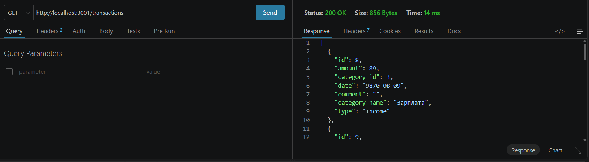
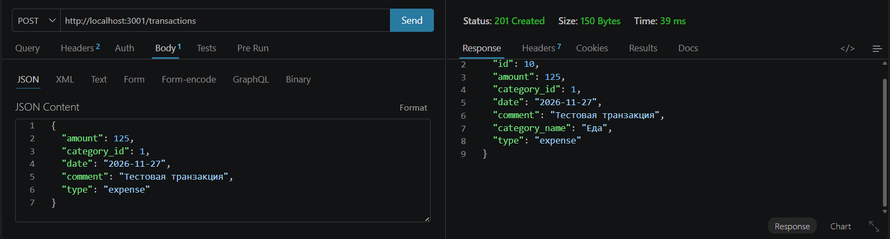
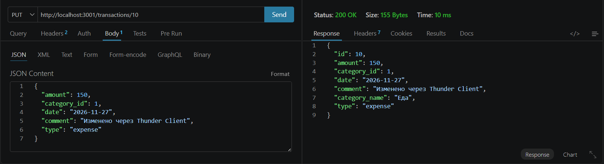
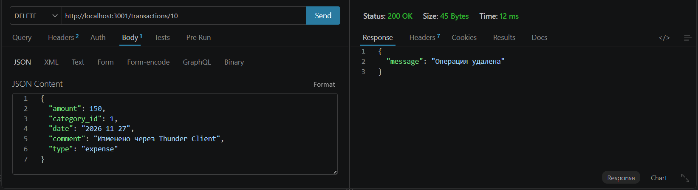

# Zen-Money

Веб-приложение для учёта личных финансов.

## Запуск

1. Откройте терминал в папке `server`.
2. Выполните команды:

```bash
npm install
npm start
```

3. Запустите `client/index.html` через Live Server.

Сервер работает по адресу `http://localhost:3001`.

## Возможности

- Добавление, просмотр, изменение и удаление транзакций.
- Создание категорий.
- Фильтрация транзакций.
- Отображение общей информации о транзакциях.

## Проверка API

Запросы проверяются в Thunder Client.

- `GET /transactions` — получить транзакции.
- `POST /transactions` — добавить транзакцию.
- `PUT /transactions/:id` — изменить транзакцию.
- `DELETE /transactions/:id` — удалить транзакцию.
- `GET /categories` — получить категории.
- `POST /categories` — добавить категорию.

## Проверка API в Thunder Client

### GET — получение списка транзакций


### POST — создание транзакции


### PUT — изменение транзакции


### DELETE — удаление транзакции

