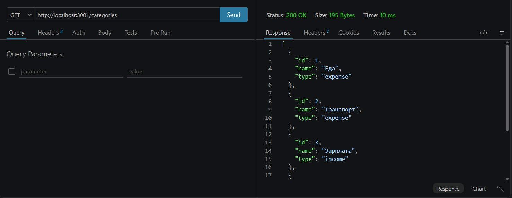
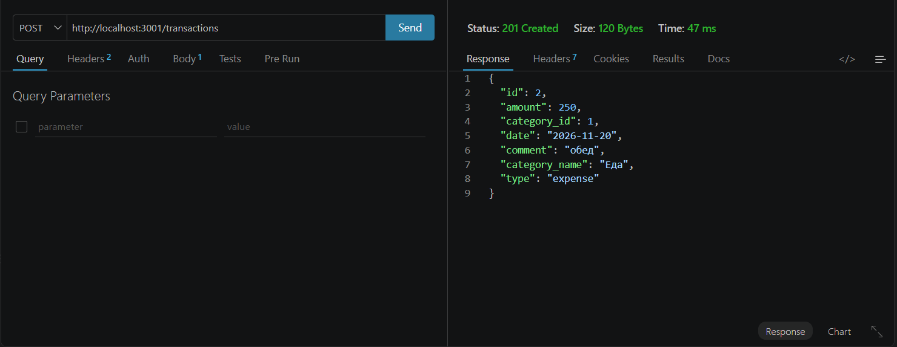
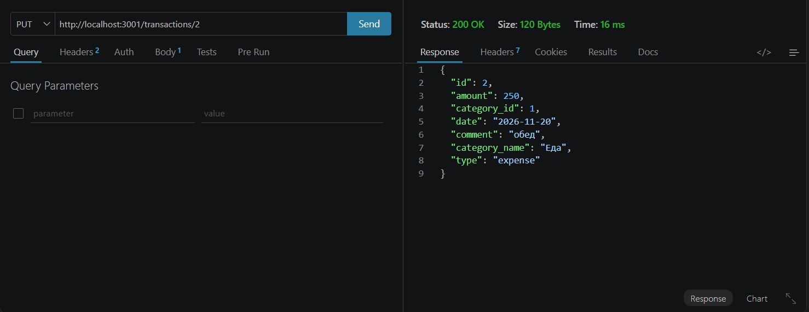
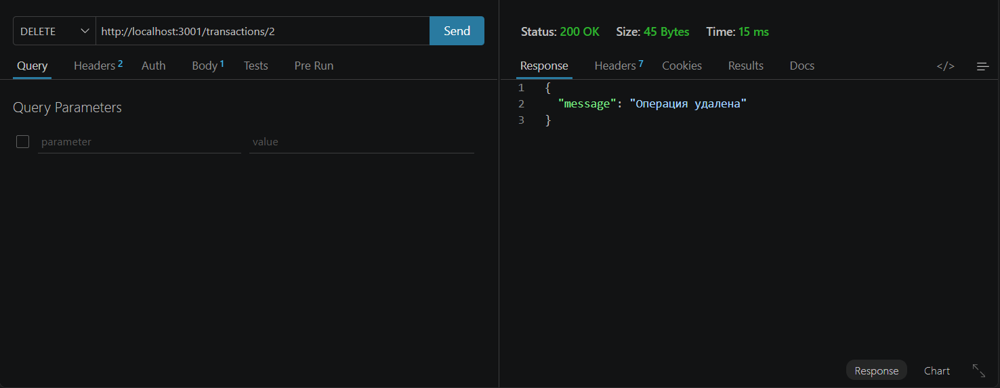

# Zen-Money — сервер (Express + SQLite)

## Установка и запуск
```bash
cd task11/server
npm install
npm start        
```
Сервер слушает `http://localhost:3001`.

База `database.sqlite` создаётся **автоматически** при первом запуске (таблицы `categories` и `transactions`, плюс стартовые категории «Еда», «Транспорт», «Зарплата»). В git файл базы не коммитится.

## Структура (MVC)
```
server/
  server.js                       точка входа: middleware, подключение роутов, обработка ошибок
  db.js                           подключение к SQLite, создание таблиц, стартовые данные
  routes.js                       URL -> контроллер
  controllers/                    C: валидация, статусы 200/201/400/404/500
    categoryController.js
    transactionController.js
    validators.js
  models/                         M: SQL-запросы (в т.ч. фильтрация через WHERE)
    categoryModel.js
    transactionModel.js
```
View в API-сервере — JSON-ответы; полноценное представление находится в `client/`.

## Маршруты
| Метод | Роут | Описание |
|---|---|---|
| GET | `/categories` | все категории |
| POST | `/categories` | создать категорию `{name, type}` |
| GET | `/transactions?category_id=&type=&from=&to=` | операции, фильтры применяются в SQL |
| POST | `/transactions` | создать `{amount, category_id, date, comment}` |
| PUT | `/transactions/:id` | обновить |
| DELETE | `/transactions/:id` | удалить |

Ошибки: `400` (невалидные данные), `404` (нет такого id), `500` — тело всегда `{ "error": "..." }`.

- GET `/categories`:

  

- POST `/transactions`:

  

- PUT `/transactions/2`:

  

- DELETE `/transactions/2`:

  
```
